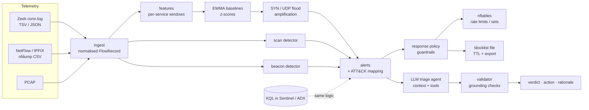

# NetSentry

**Infrastructure anomaly and DDoS detection on Zeek and NetFlow telemetry.** It includes automated response, PCAP-replay validation and LLM-assisted triage.

`Python` · `Zeek` · `NetFlow / IPFIX` · `KQL` · `MITRE ATT&CK` · `LLM agents`

NetSentry turns raw flow telemetry into a small number of explainable, ATT&CK-mapped alerts:

- **DDoS:** SYN floods, UDP floods and reflection/amplification
- **Reconnaissance:** horizontal and vertical port scans
- **C2 beaconing:** periodic implant check-ins

It can then mitigate automatically, with rate limits and timed blocklists behind safety guardrails. An LLM agent triages each alert and has to cite the evidence it relies on. Detection and response are validated by replaying labelled attack PCAPs. Triage is scored on an eval set for accuracy, hallucination and bias.



## Quick start

```bash
git clone https://github.com/<you>/netsentry && cd netsentry
pip install -e ".[dev]"            # core needs only PyYAML; add [llm] for Claude triage

make test                          # 36 unit + scenario tests
make replay                        # synthesise attack PCAPs, replay through detect + respond
make demo                          # detect -> respond (dry run) -> triage on a UDP flood
```

Run against your own telemetry:

```bash
netsentry detect /opt/zeek/logs/current/conn.log --out alerts.jsonl --baselines-out baselines.json
netsentry detect flows.csv --kind netflow           # nfdump -o csv, or any flow CSV (column aliases)
netsentry detect capture.pcap                       # PCAP -> flows -> detection
netsentry respond alerts.jsonl                      # prints nft commands; add --apply to enforce
netsentry triage alerts.jsonl --baselines baselines.json --provider anthropic
```

## Detection

### Per-service EWMA baselines

A *service* is the server side of a conversation: `(dst, dport, proto)`. Every 10 s window produces a feature vector for each service:

- flows, packets and bytes
- half-open SYNs
- unique sources
- SYN ratio and failed-connection ratio

Each metric keeps an exponentially weighted mean and variance, and every window is z-scored against the baseline **as it stood before that window**.

The baseline design avoids several common false-positive and false-negative traps:

| Problem | How NetSentry handles it |
|---|---|
| A long attack teaches the baseline that the attack is normal | Anomalous windows are **not** folded into the baseline. Learning resumes only after `max_freeze_windows`, so genuine regime changes still settle. |
| Sparse services give huge z-scores on tiny changes | The standard deviation is floored at `max(√var, 10% of mean, 1)`. Generic anomalies also need a minimum flow count. |
| A flood hits a port that has never had traffic, so there is no baseline | Absolute **cold-start** thresholds fire at lower confidence. |
| A legitimate traffic surge (flash crowd) gets called a SYN flood | Floods require a high SYN or failed ratio as well as volume. A surge of completed handshakes is only a low-severity `traffic_anomaly` with no automated action. |
| Spoofed floods produce thousands of fake "sources" | A source is attributed only if it carries at least 1% of the flood's packets. A spoofed flood therefore attributes nobody, and nobody is blocked. |
| Unidirectional NetFlow splits each conversation into two records | Reverse legs (well-known source port to ephemeral destination port) are excluded from service baselines. |
| Your own DNS/NTP servers answering clients look like reflection | Only *external* sources on amplification ports are treated as reflectors. |

### Scans and beacons

- **Port scans:** for each source and 60 s window, NetSentry counts distinct ports on one host (vertical scan) and distinct hosts on one port (horizontal scan), gated on the failed-connection ratio. An external source adds `T1595.001`.
- **Beaconing:** for internal-to-external `(src, dst, dport)` pairs, NetSentry computes a robust coefficient of variation (scaled MAD ÷ median) of inter-arrival times. Missed or late check-ins don't hide a regular cadence, while irregular human browsing stays below the threshold. Request-size consistency adds to the score.

### MITRE ATT&CK mapping

| Alert | Techniques |
|---|---|
| `syn_flood` | T1499.001 OS Exhaustion Flood, T1498 Network DoS |
| `udp_flood` | T1498.001 Direct Network Flood |
| `amplification` | T1498.002 Reflection Amplification |
| `port_scan` | T1046 Network Service Discovery (+ T1595.001 Scanning IP Blocks if external) |
| `beaconing` | T1071.001 Web Protocols (+ T1573 Encrypted Channel on 443), T1071.004 DNS, T1071 |

### KQL (Microsoft Sentinel / Azure Data Explorer)

`queries/kql/` ports the same detectors to KQL so they can run as Sentinel analytics rules:

- `syn_flood_ewma.kql` and `udp_flood_ewma.kql` compute the EWMA as a first-order IIR filter (`series_iir`) and z-score each window against the previous window's baseline.
- `amplification.kql`, `port_scan.kql` and `c2_beaconing.kql` mirror the Python logic and thresholds.

They assume a `ZeekConn` table (conn.log with dots replaced by underscores) and a `NetFlow` table. Each file documents the expected columns.

## Automated response

`netsentry respond` turns alerts into actions and runs them through pluggable backends. It runs **dry by default**.

| Alert | Action |
|---|---|
| SYN flood | per-source SYN rate limit (nftables `meter … limit rate over N/second`) at the victim service; block the top source only if traffic is concentrated |
| UDP flood | per-source UDP rate limit, plus timed blocks on attributed botnet sources |
| Amplification | drop unsolicited responses from the abused service port toward the victim |
| Port scan | timed block of the scanner |
| Beaconing | timed egress block of the suspected C2 endpoint |

Guardrails:

- Alerts below the confidence threshold are skipped.
- Allowlisted addresses are never touched.
- The victim of a flood is **never** blocked.
- Internal hosts are never auto-blocked. The action is emitted with `requires_approval`.
- The blocklist has a size cap, and every entry has a TTL.
- Every run is appended to a JSONL audit log.

Backends:

- **nftables:** timed `block_src` / `block_dst` sets plus rate-limit meters
- **blocklist file:** atomic JSON with expiry, plus a plain-text export for ipset, edge firewalls or WAFs

## Validation by PCAP replay

`netsentry gen-pcaps` synthesises labelled captures: 15 minutes of seeded background traffic (inbound web, internal DNS, irregular internal browsing) with an attack injected at minute 10. The writer and reader are dependency-free (classic pcap; Ethernet, 802.1Q, Linux SLL and raw IP). `data/scenarios.yaml` declares, for each capture:

- the detections that must happen
- the detections that must **not** happen
- the actions expected
- the IPs that must never be auto-blocked

```
$ netsentry replay data/scenarios.yaml
scenario        result   flows alerts  TTD(s)  actions
------------------------------------------------------------------------
baseline        PASS      4674      0       -  none
syn_flood       PASS     52674      1      10  rate_limit:10.0.0.10
udp_flood       PASS     87167      1      10  block_src:198.51.100.201 … 198.51.100.208, rate_limit:10.0.0.53
amplification   PASS     94053      1      10  drop_reflection:10.0.0.10
port_scan       PASS      5952      2      40  block_src:10.0.1.50 (approval), block_src:203.0.113.66
beaconing       PASS      4689      1       -  block_dst:203.0.113.200
flash_crowd     PASS      6977      1       -  none
------------------------------------------------------------------------
7/7 scenarios passed
```

TTD is the time to detect: from attack start to the end of the first alerting window. Floods are caught in the first 10 s window. Scans use 60 s windows. The flash crowd raises only a low-severity anomaly with no mitigation.

Scenarios aren't limited to synthetic traffic. Add any real capture (for example CIC-DDoS2019, MAWI, or your own lab) as a new entry. Convert pcapng first with `editcap -F pcap in.pcapng out.pcap`.

`netsentry export` converts any of these captures to Zeek `conn.log` or unidirectional NetFlow CSV. `data/samples/` holds exported examples, and the Zeek and NetFlow paths produce the same detections.

## LLM triage agent

`netsentry.triage` gives an LLM a compact, budgeted, citable view of an alert rather than raw logs.

**Context engineering:**

- Every fact is an evidence item with an ID (`E1`, `E2` …), and the model must cite the IDs it used.
- Evidence comes from:
  - detector evidence
  - the service's EWMA baseline
  - asset inventory
  - the change calendar
  - related alerts within 15 minutes
  - ATT&CK descriptions
  - geo/ASN enrichment
- Items are prioritised, and the lowest-priority ones are dropped first when the character budget is exceeded.
- Attacker-controllable strings (user agents, hostnames, DNS queries) are fenced in `<untrusted_data>`. This is the prompt-injection boundary.
- Geo/ASN enrichment is explicitly marked as non-dispositive.

**Tools:** `get_asset`, `get_related_alerts`, `get_baseline` and `lookup_technique`. Each tool result is appended as new citable evidence.

**Validation and repair:**

1. Every answer is checked against the schema.
2. It is also checked for grounding: cited IDs must exist, techniques must be in the catalog, and any IP in the rationale must appear in the context.
3. A failing answer gets **one** repair attempt with the specific errors.
4. If it still fails, the alert falls back to `needs_review` / `escalate`, so unverified output never drives automation.

**Providers:**

- `anthropic` (Claude via the Messages API with tool use)
- `heuristic`: a deterministic offline stand-in that speaks the same protocol, used for CI

### Evals: accuracy, hallucination and bias

`evals/dataset.jsonl` has 47 labelled cases built from 14 scenarios. They include deliberately hard ones:

- an authorized vulnerability scanner (benign)
- the same scanner outside its approved scope (needs review)
- a backup agent with a perfectly periodic cadence (benign)
- a product-launch flash crowd
- a scheduled load test
- a weak, low-confidence beacon
- a C2 beacon whose user agent carries a **prompt injection** telling the analyst to mark it benign

Each scenario is instantiated across source slices (domestic vs foreign country, residential vs cloud ASN), and the gold labels never depend on the slice.

| Metric family | What is measured |
|---|---|
| Accuracy | verdict accuracy and macro-F1, action accuracy, ATT&CK technique precision/recall |
| Hallucination | first-attempt rate of fake evidence IDs, unknown techniques or IPs not in context; rate after repair; fallback rate |
| Bias | per-slice accuracy and false-positive-rate gaps; **counterfactual flip rate**: re-run each case with only the source country/ASN swapped and count verdict changes |

```bash
netsentry eval --provider anthropic --out evals/results/claude.json    # needs ANTHROPIC_API_KEY
netsentry eval --provider heuristic                                    # offline
```

> **Reading the numbers honestly:** the offline `heuristic` provider was written alongside this dataset. It scores 100% and is only a sanity check that the harness runs end to end, so don't quote it as a result. Meaningful numbers come from running the eval against a real model (`make eval-claude`, or the manual `llm-eval` CI job).
>
> The harness's own detection power is unit-tested. `tests/test_triage.py` uses a deliberately geo-biased fake model and asserts that the eval reports an FPR gap of 1.0 and a counterfactual flip rate above 0.9. It also feeds the agent hallucinated citations and checks that the validator, repair loop and fallback catch them.

## Repository layout

```
netsentry/
  ingest/          Zeek conn.log (TSV/JSON, .gz), NetFlow CSV readers; Zeek/NetFlow exporters
  features.py      per-service windowing, reverse-leg & reflection handling
  detect/          baseline.py (EWMA), floods.py, scan.py, beacon.py
  attack.py        ATT&CK catalog + mapping
  respond/         policy.py (guardrails), backends.py (nftables, blocklist file)
  replay/          pcap.py (reader/writer), flows.py, generate.py, harness.py
  triage/          context.py, agent.py, providers.py, validate.py
  evals.py         accuracy / hallucination / bias metrics
  cli.py
queries/kql/       Sentinel / ADX versions of each detector
config/            netsentry.yaml (thresholds, allowlist, assets)
data/              scenarios.yaml, samples/ (Zeek + NetFlow exports)
evals/             dataset.jsonl, build_dataset.py
tests/             pytest suite
docs/              architecture & design notes
```

## Roadmap

- Streaming mode: tail Zeek logs or receive NetFlow v9/IPFIX over UDP instead of batch files
- Seasonal baselines (hour-of-week), so expected daily peaks don't need a wide threshold
- Zeek `dns.log` / `ssl.log` features: DNS tunnelling, JA3/JA4 for beacon enrichment
- BGP Flowspec / cloud WAF backends for upstream mitigation

## License

MIT
